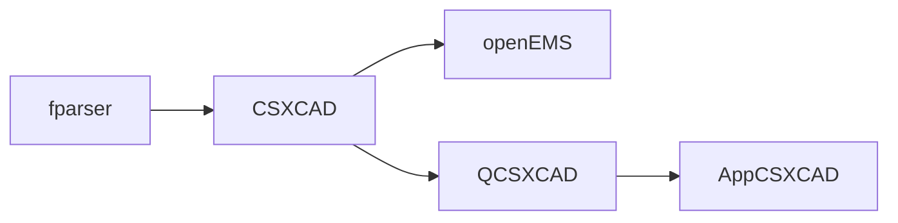
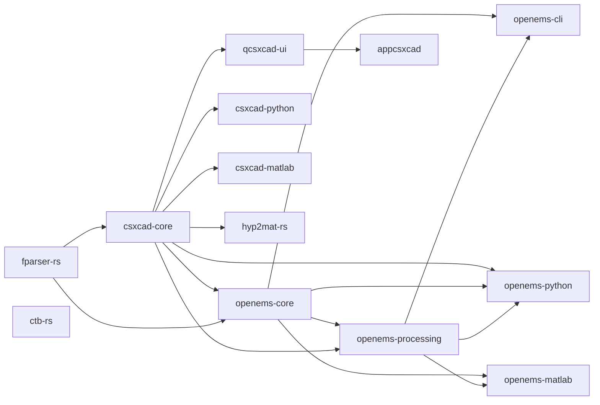

# Rust Migration Plan

## Objective and constraints

Migrate the openEMS-Project stack to a Rust-native implementation while
preserving its scientific behavior, public interfaces, file compatibility,
supported workflows, and performance requirements. This plan records the audited repository and submodule structure, component
source/API surfaces, and representative original numerical baselines. The user
explicitly directed implementation to begin on 2026-10-16, starting with
fparser. That authorizes the migration sequence and scoped engineering
decisions; it does not settle every compatibility question, optional
dependency, or final comparison tolerance.

The root repository is build, documentation, and helper-script glue. The
simulation and component implementations are maintained in independent
submodule repositories with separate licenses and contribution rules. A Rust
migration must respect those boundaries; do not change a submodule pointer to
an unpushed commit.

## Verified architecture and dependency map

The root `CMakeLists.txt` defines these build dependencies:

The GUI branch is optional in the root build. `hyp2mat` and `CTB` are separate
submodules with their own conversion and Matlab/Octave functionality; their
source contracts and build relationships are mapped in their component audits.
`hyp2mat` depends on CSXCAD output, while CTB is an independent Matlab/Octave
network-analysis library.

Verified functional boundaries:

- **fparser** evaluates mathematical expressions used by CSXCAD parameters.
- **CSXCAD** models geometry and properties and serializes the public XML
  interchange format; it also has C++, Cython/Python, and Matlab/Octave
  interfaces.
- **openEMS** parses CSXCAD input and runs the 3-D FDTD solver. Its inspected
  project guidance identifies the operator/engine, processing, NF2FF, SAR,
  Octave/Matlab, and Python surfaces.
- **QCSXCAD** is a Qt/VTK GUI library for viewing and editing CSXCAD structures;
  **AppCSXCAD** is its desktop application.
- **hyp2mat** converts HyperLynx/QucsStudio PCB input for simulation or PDF
  output; **CTB** supplies Matlab/Octave network-parameter and Touchstone
  utilities.

## Required gates and work order

1. **Complete the audit before porting.** Inventory every relevant source file,
   class, function, build option, integration point, data format, test, and
   platform-specific path in every pinned submodule. Read each component's
   local instructions. Classify TODOs and unsupported cases by evidence rather
   than treating markers as confirmed defects.
2. **Establish reference behavior.** Build and run the original stack on a
   supported environment. Capture representative inputs, intermediate solver
   data where accessible, end-to-end outputs, performance, and toolchain
   details. Define case-specific numerical acceptance criteria from those
   results and analytical references.
3. **Approve the target architecture.** Map each inventoried original unit to
   a proposed Rust unit, document public API and file-format compatibility,
   and evaluate native dependencies (including Qt/VTK, HDF5, XML, and Python
   integration) before selecting crates or FFI. Do not claim Rust-native status
   while required C/C++ implementations remain.
4. **Port in dependency order, one validated unit at a time.** The provisional
   foundation order follows the verified graph: fparser, CSXCAD, then
   openEMS. Migrate QCSXCAD and AppCSXCAD after their data/API boundary is
   stable. Migrate hyp2mat after CSXCAD; CTB is independent and can follow its
   own numerical compatibility gate. Preserve legacy sources until differential
   and integration acceptance criteria pass.
5. **Integrate and verify the full stack.** Recreate supported builds,
   packaging, scripting interfaces, formats, and workflows. Run the relevant
   component suites, differential/scientific benchmarks, compatibility tests,
   and end-to-end smoketests on supported platforms.

Each gate must leave traceable evidence in `MIGRATION_STATUS.md`,
`COVERAGE_MATRIX.csv`, and `VALIDATION.md`. A failed or unavailable gate is a
blocker, not an implicit pass.

6. **Track upstream continuously.** The fork follows
   `thliebig/openEMS-Project`. The main project merges upstream into
   `modernization/integration`; the Rust audit branches merge the same commits
   in each submodule. Every upstream commit since the last pin is classified in
   `audits/upstream-sync-<date>.md` as one of:

   | Class | Meaning |
   | --- | --- |
   | Ported | the behaviour exists in Rust, with a test in the same change |
   | Present | the Rust port already implemented it (evidence named) |
   | Not applicable | C++/GPU/packaging/CI-only change |
   | Deferred | not yet ported; the reason and the verification it needs are recorded |

   A behavioural upstream change may only be marked Present/Ported after an
   executed Rust test; Deferred rows are open work, not passes.

## Acceptance criteria

Completion requires every coverage-matrix row to have a mapped implementation
and validation evidence; supported builds, interfaces, file formats, and
workflows to operate; and original-vs-Rust scientific comparisons to meet
case-specific criteria with unexplained discrepancies resolved. Performance
and platform regressions must be measured and addressed. Remaining native
dependencies and justified exceptions must be documented. Compilation alone
does not satisfy any scientific or functional acceptance criterion.

## Proposed Rust architecture (for review)

This architecture is the approved sequencing basis for implementation under
the user's 2026-10-16 direction; optional dependencies and unresolved
component-specific policies remain provisional. Keep the existing stack as
the behavior oracle and migrate each component in its owning submodule
repository, preserving that repository's license, release history, and review
boundary. Keep CMake and the current install flow as the transition build
until a Rust replacement passes the same integration and platform checks. Do
not change a submodule pointer until its Rust commit is pushed and reviewed
upstream.

The proposed logical crates and dependencies are:

| Original component | Proposed Rust unit | Responsibility and dependencies |
| --- | --- | --- |
| `fparser/` | `fparser-rs` | Tokenization, parsing, bytecode/evaluation, built-ins, error codes, user functions, and optimizer compatibility. No runtime dependency is assumed. |
| `CSXCAD/` | `csxcad-core` | Typed structure/property/primitive/grid/transform model and XML/HDF5-facing data contracts; depends on `fparser-rs`. |
| `openEMS/` solver | `openems-core` | Mesh indexing, field state, FDTD operators, boundary/excitation/material updates, engine selection, and termination; depends on `csxcad-core` and `fparser-rs`. |
| `openEMS/` processing | `openems-processing` | Probes/dumps, legacy/current HDF5, VTK, NF2FF, SAR, and numerical post-processing; depends on `openems-core` and `csxcad-core`. |
| `openEMS/` executable | `openems-cli` | Stable command-line, configuration, logging, output-path, and process-exit contract over the core and processing crates. |
| Python interfaces | `csxcad-python`, `openems-python` | Compatibility adapters preserving module/class names, method signatures, array shapes, ownership, and exception behavior. They wrap the Rust APIs rather than duplicate domain logic. |
| Matlab/Octave interfaces | `csxcad-matlab`, `openems-matlab` | Compatibility adapters for the required M-file surface. A shared C ABI with thin MEX/Octave entry points is the initial candidate; pure-M-file orchestration remains until each behavior is ported and verified. |
| `QCSXCAD/`, `AppCSXCAD/` | `qcsxcad-ui`, `appcsxcad` | Rust-owned GUI state and workflows over the approved geometry API. Qt/VTK integration is an unresolved binding decision requiring a build/runtime spike; a C++ bridge is transition glue, not a completed Rust GUI. |
| `hyp2mat/` | `hyp2mat-rs` | HyperLynx parsing and audited CSXCAD/PDF/QucsStudio exporters; depends on `csxcad-core`. |
| `CTB/` | `ctb-rs` | Network-parameter transforms and Touchstone readers/writers; independent of the solver graph. |
| Root repository | Integration workspace/build | Pins component revisions, coordinates Cargo and legacy builds, packages the supported interfaces, and runs cross-component tests. |

These are logical boundaries. The initial `fparser-rs` package now lives at
`fparser/rust`; other package names, exact locations, the Cargo workspace
layout, and dependency versions remain provisional. Each package should
remain independently buildable in its owning repository, while the root
integration build supplies pinned local component paths for combined
development. This avoids moving licensed source into the meta-repository and
keeps submodule commits independently reviewable.

The recommended packaging shape is standalone crate packages under their
owning submodules, with a root integration Cargo workspace that lists those
packages and overrides versioned sibling dependencies with the checked-out
submodule paths. The component package must still build from its own upstream
clone; the root workspace lockfile makes the combined CI build reproducible.
The existing CMake/ExternalProject flow remains authoritative until the root
workspace can build, install, and test every migrated unit.

This mapping follows the recorded evidence: fparser grammar, optimizer,
numeric variants, and evaluator effects are in `audits/fparser.md`; CSXCAD
ownership, typed model, XML, and wrapper contracts are in
`audits/csxcad-native.md` and `audits/csxcad-interfaces.md`; openEMS solver
ordering and extension behavior are in `audits/openems-core.md`, while field,
HDF5, NF2FF, SAR, and scripting contracts are in
`audits/openems-processing.md` and `audits/openems-interfaces.md`. The Qt/VTK
boundary is mapped in `audits/gui.md`; CTB and hyp2mat contracts are in their
component audits. The captured original outputs and provisional scientific
limits are in `VALIDATION.md` and `reference-data/`; they do not yet authorize
Rust tolerances.

### Interface, format, and dependency policy

- Preserve observable public contracts at adapters: names, defaults, units,
  coordinate order, array orientation, ownership/lifetime, error identifiers,
  CLI exit behavior, and documented file paths. Internally, use typed Rust
  errors and validated domain types; translate errors at the boundary. Do not
  silently change a confirmed legacy defect. Each behavior that might be
  corrected needs an explicit compatibility decision and regression case.
- Treat XML, legacy/current HDF5, VTK, Touchstone, `.hyp`, STL, and PLY as
  public interchange formats. Start with read/write fixtures from the pinned
  stack. Preserve byte-level serialization only where observed callers or
  tests depend on it; otherwise define structural/value-level equivalence
  before changing serializers.
- Keep `f64` as the first solver target and preserve the measured Yee-grid
  update order, precision, extension ordering, and deterministic fixed-step
  stopping path. Add SIMD/threaded paths only behind differential tests.
  `fparser-rs` covers only the default real `f64` parser. Optional float,
  long-double, integer, complex, MPFR, and GMP variants are out of scope for
  this crate; the original C++ implementation remains the compatibility path
  for consumers that need them until a separately approved migration task
  provides runtime evidence. No Rust backend may imply those variants are
  covered.
- Add no dependency before a reviewed need and platform/license check. Candidate
  integration points to spike, not select here, are: direct HDF5 C API versus
  a Rust wrapper; TinyXML compatibility bridge versus a Rust XML parser;
  PyO3 versus a narrower CPython ABI; MEX/Octave adapters over a stable C ABI;
  and Qt/VTK bindings for the GUI. Prefer the smallest wrapper surface that
  keeps file and API behavior testable across the existing CI matrix.
- Recommended first adapter shape: a Rust Python extension using PyO3 after
  ABI/NumPy packaging validation; a stable C ABI for MATLAB MEX and Octave
  shims; existing HDF5 and Qt/VTK libraries behind narrowly-scoped FFI during
  transition; and TinyXML compatibility until XML differential tests support
  a pure-Rust parser. These are candidates for the approval decision, not
  permission to add dependencies.
- Keep business logic in the Rust crates. Any remaining C/C++ code must be
  limited to external libraries or reviewed ABI glue and documented as an
  exception; the project must not claim the whole stack is Rust-native while
  required component logic remains in C/C++ or M-files.

### Migration units and acceptance evidence

1. **`fparser-rs`:** Port tokenizer/parser/evaluator first, then optimizer.
   Differential tests cover precedence, units, degree mode, functions and
   callbacks, type variants, error codes, lifetimes, and optimized versus
   unoptimized side effects/errors. Generated rewrite rules and optional
   backends remain gated until their compatibility scope is decided.
2. **`csxcad-core`:** Port model/ownership, parameters, geometry, transforms,
   mesh, and XML in separable units. Test object lifetime/identity, coordinate
   transforms, bounds, property values, serialization round trips, and
   malformed/partial XML against pinned fixtures.
3. **`openems-core`:** Port grid setup, field layout, operators, engine
   scheduling, boundaries, excitations, materials, and termination in the
   audited update order. Compare intermediate fields and end results using
   the preserved references, including the converged 3D coax and analytic
   conducting sheet; require approved case-specific tolerances before claiming
   numerical acceptance.
4. **`openems-processing` and `openems-cli`:** Port data/probe/dump I/O, HDF5,
   VTK, NF2FF, SAR, logging, cleanup, and command behavior. Verify structural
   file compatibility, Python/M-file readers, analytic processing results,
   and error/exit paths.
5. **Adapters:** Port and test Python and Matlab/Octave surfaces incrementally,
   retaining the original wrappers as the oracle until each signature and
   workflow passes. Validate packaging/imports, arrays and ownership, errors,
   smoke tests, and the end-to-end MSL tutorial.
6. **Auxiliary tools and GUI:** Port CTB with its MATLAB numerical/Touchstone
   corpus and port hyp2mat with parser/export fixtures. Migrate the GUI only
   after the `csxcad-core` boundary and Qt/VTK spike are accepted; test project
   load/save, editing, rendering, and export on supported platforms.
7. **Root integration and acceptance:** Replace `ExternalProject_Add` and
   helper scripts only after their component replacements install correctly.
   Run clean builds, component suites, differential/reference cases,
   packaging, smoke tests, and the supported platform matrix before removing
   legacy code.

The user explicitly directed implementation to begin on 2026-10-16. This
authorizes proceeding on the migration sequence and making scoped technical
decisions as each unit is implemented. It does not silently settle every
compatibility question: observed source defects, final numeric tolerances,
Python/MATLAB packaging, GUI binding strategy, and any added dependencies must
still be resolved and documented before their respective units depend on them.
Optional numeric variants are explicitly excluded from the initial `fparser-rs`
scope as stated above. The current analytics and cross-platform gaps are
evidence limitations, not permission to relax acceptance criteria.

## Initial audit artifacts

- `MIGRATION_STATUS.md` records inspected state, blockers, and the next audit
  or approval gate.
- `AUDIT_FINDINGS.md` indexes confirmed source behavior, open questions, and
  runtime blockers across component audits.
- `COVERAGE_MATRIX.csv` maps component/source families to proposed Rust units;
  detailed declaration inventories and source contracts remain in component
  audits, and implementation/validation evidence is still required per unit.
- `VALIDATION.md` records the captured original-stack evidence and distinguishes
  provisional criteria from approved Rust tolerances; no final Rust tolerances
  have been approved.
