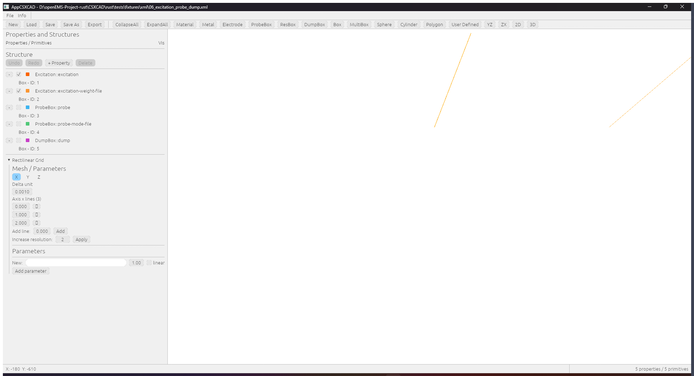
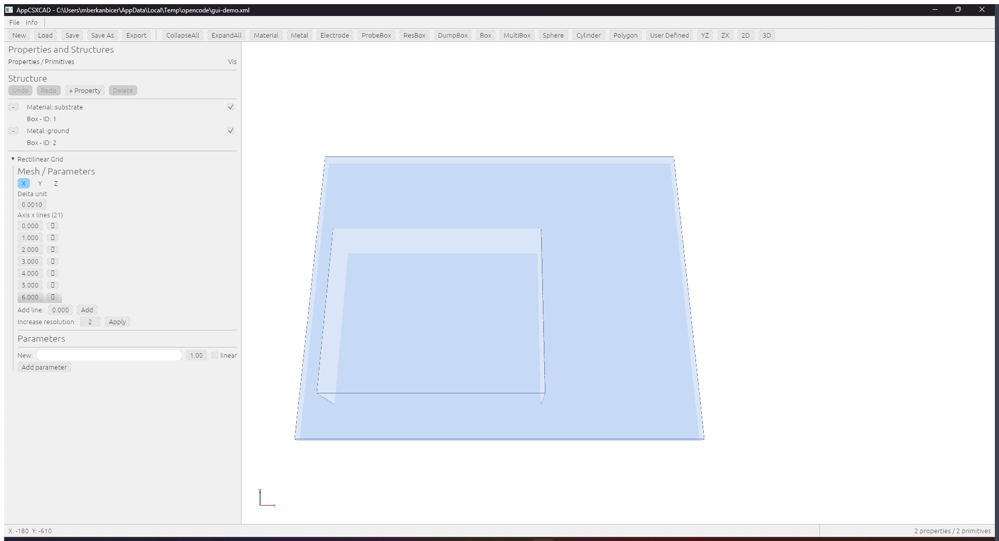

# GUI parity audit (E-006)

**Date:** 2026-10-29
**Question:** does the Rust GUI match the native QCSXCAD/AppCSXCAD in design and
usability?

**Answer: no.** E-006 recorded the missing native side-by-side comparison. This
audit records the larger fact behind it: the current GUI is an **egui/wgpu**
application (ADR 0004, D-04), so it is a different toolkit with a different
layout, theme and interaction model. It is not a visual near-match that a
side-by-side would confirm; the design is different.

## Reference

| Native AppCSXCAD (Qt Widgets, `doc-src/concepts/images/appcsxcad.png`) | Rust port (`audits/gui-windows.png`) |
| --- | --- |
| Light Qt theme, native menu and toolbar metrics | Dark egui theme, custom top bar |
| `File`, `Info` menus | `File`, `Info` menus (different contents) |
| Text toolbar: `homo`, `inhomo`, `increase Disc`, `detect edges`, `CollapseAll`, `ExpandAll`, `Material`, `Metal`, `Excitation`, `ProbeBox`, `ResBox`, `DumpBox`, `Box`, `MultiBox`, `Sphere`, `Cylinder`, `Polygon`, `User Defined`, `YZ`, `ZX`, `2D`, `3D` | No object/view toolbar; a `QCSXCAD 5 properties / 5 primitives` strip and `Undo`/`Redo`/`+ Property`/`Delete` |
| Dock **Properties and Structures** with the columns `Properties / Primitives` and `Vis` | Tree with native row labels but no column headers and a different row metric |
| Dock **Rectilinear Grid**: X/Y/Z `Min`/`Max Lines`, `Edit`, `Drawing unit [m]`, `Grid opacity` | Absent; grid editing is a separate panel |
| Dock **Parameter**: list plus `New` | Absent as a dock |
| Status bar with live `X:`/`Y:` coordinates | Absent |
| Viewport with X/Y axis gizmo and `YZ`/`ZX`/`2D`/`3D` presets | Viewport with orbit camera, no axis gizmo or presets |
| Property/primitive editors in-place in the tree flow | Editors in a side panel |

The functional model is ported (tree labels, editors, undo, exports, renderer),
but "birebir aynı tasarım ve kullanışlılık" is not met.

## Why it happened

D-04 chose `egui` + `wgpu` over Qt bindings and accepted the toolkit change as a
design decision. The migration then verified the model, the renderer and the
exporters, not visual parity. The user now requires parity, which reopens D-04.

## Options

| Option | What it means | Effort | Keeps all-Rust | Risk |
| --- | --- | --- | --- | --- |
| **A. Qt Widgets in Rust (cxx-qt)** | Port `AppCSXCAD.cpp`/`QCSXCAD` to Rust Qt Widgets, mirror the menus, toolbar, docks, tree columns, grid/parameter panels and status bar; embed the existing wgpu view in a `QWidget`/`QWindow` container | 4-8 weeks | yes | Qt5/6 dev dependency in the Rust build; wgpu-in-Qt surface handling; the largest single work item left |
| **B. Native Qt GUI + Rust core via C ABI** | Keep the native Qt AppCSXCAD front-end (exact UI) and drive the Rust structure/operator/engine through a reviewed C ABI | 1-2 weeks | no (a C++ GUI remains) | Reopens D-08 (no C++ compatibility surface); the C ABI grows |
| **C. egui restyle to the Qt layout** | Light theme, text toolbar, left docks for Properties/Grid/Parameter, tree column headers, status bar, axis gizmo and view presets | 1-2 weeks | yes | Close in layout and workflow, never pixel-identical (fonts, metrics, native widgets) |

## Recommendation

If "birebir" is literal, only **B** delivers it in a reasonable time; **A** is
the only path that is both literal and all-Rust. **C** is the cheapest way to
close most of the usability gap but cannot claim identity.

The work should not start before this choice is recorded as a new ADR that
supersedes D-04 (and, for B, D-08).

## Tool constraint and the all-Rust path

`cxx-qt-lib` 0.10 has no `QWidget`/`QMainWindow` bindings (only `qt_gui`,
`qt_qml`, `qt_quickcontrols`), and the owner requires an **all-Rust** product.
ADR 0009 therefore reproduces the native layout in the existing egui/wgpu
application and accepts the toolkit residual (fonts, native dialogs, widget
metrics). The Qt prototype in `AppCSXCAD/qt-prototype/` is the layout
reference only; it is not shipped.

The first functional slice is implemented:

* light Fusion-like palette, white viewport, native text toolbar;
* toolbar actions create a `Material`/`Metal`/`Excitation`/`ProbeBox`/`ResBox`/
  `DumpBox` property and a `Box`/`MultiBox`/`Sphere`/`Cylinder`/`Polygon`/
  `User Defined` primitive on the selected property;
* `CollapseAll`/`ExpandAll` and the `YZ`/`ZX`/`2D`/`3D` view presets;
* clicking the viewport selects the nearest primitive (projected bounding
  box), expands its property and opens the primitive editor;
* middle-drag orbits the camera and the wheel zooms;
* the Move/Rotate/Scale toolbar tools choose what a viewport drag does;
* Alt-drag (or the Rotate tool) rotates the selected primitive around the
  world z axis; the Scale tool scales it; each gesture is one undo step;
* the right dock shows the Property, Primitive and Transform editors when a
  node is selected, with numeric dX/dY/dZ, X/Y/Z degrees, per-axis sX/sY/sZ scale and reset;
  every primitive type can be moved (boxes/spheres by coordinates, the rest
  through the transform);
* dragging the selected primitive moves it in the camera plane (one undo
  step for the whole drag);
* the axis gizmo in the lower-left corner and the `Vis` checkbox in its
  right-hand column;
* the `Rectilinear Grid` and `Parameter` docks are separate sections;
* the dock order is fixed (the editors were previously created after the
  central panel and therefore never reserved their width).
* `Properties and Structures` with the `Properties / Primitives` and `Vis`
  headers, the `Rectilinear Grid` dock (mesh and parameters), the coordinate
  status bar and a white viewport.



A created model renders immediately: the demo below is a loaded
`Material` box on a `Metal` ground plane, with the tree, the grid dock and
the status bar:



Usage as a CAD editor: load or create a project (new projects start with a
20 mm grid), pick a property (or create one with `Material`), add a primitive
with the object buttons (Box and Sphere start as a visible 10 mm shape), edit
its geometry and priority in the right-hand primitive editor, edit the
material in the property editor, toggle visibility in the tree, use
`Undo`/`Redo`, adjust the grid/parameters in the left dock, switch the view
with `YZ`/`ZX`/`2D`/`3D` and export through `File > Export`.

`toolbar_creates_a_property_and_a_primitive` exercises create → undo, and
`a_created_box_is_visible_and_exported` checks the non-degenerate bounds, the
default grid, the XML export and the re-parsed 10 mm cube (nine app tests
pass), and `clicking_the_viewport_selects_the_primitive` covers the viewport
hit test and the empty-space miss; the geometry move and its single-step undo
are covered by `a_viewport_gesture_moves_a_primitive_and_undo_restores_it`.
The CAD workflow is complete: create, edit, pick, move (drag), rotate
(Alt-drag), orbit, zoom, grid/parameters, visibility, undo and export. The
toolbar uses the native QCSXCAD PNG icons for the file, collapse/expand and
exit actions (embedded from `QCSXCAD/images`), and the widget metrics follow
the Qt row rhythm and 14 px text. The object-type buttons stay text, as in
the native toolbar.

## Mouse input verification (2026-10-29)

The viewport was driven with **real mouse input** on the running Windows
build (`target/release/appcsxcad.exe`, maximized, demo project
`Material` box + `Metal` ground plane, screenshot
`gui-mouse-baseline.jpg`). The helper moves the cursor with
`SetCursorPos` and clicks with `mouse_event` after forcing the window to the
foreground; the application records the gesture in the file named by
`QCSXCAD_INPUT_TRACE` (`qcsxcad_egui::trace_input`). The captured trace:

```text
pick id=1 at=(940,480)          <- click selects Box - ID: 1
drag_start id=1 mode=Move
move id=1 dx=1.48053e-1 dy=-1.39077e-1 dz=-5.07671e-2   (x15)
drag_start id=1 mode=Rotate     <- after clicking the Rotate tool
rotate id=1 angle_rad=0.07000   (x16)
drag_start id=1 mode=Scale      <- after clicking the Scale tool
scale id=1 factor=1.16000       (x30)
orbit dx=-5.0 dy=-4.0 yaw=-1.5208 pitch=1.1808          (x15)
zoom distance=36.43122 / 40.07434
```

| Interaction | Evidence |
| --- | --- |
| Click the 3D viewport | `pick id=1 at=(940,480)`; the tree highlights `Box - ID: 1` and the right dock opens the Primitive/Transform editors (`gui-mouse-select.jpg`) |
| Left-drag the selected box | 15 `move` lines; the primitive coordinates change from `(2,2,2)-(12,12,6)` to `(4.44,0.02,1.27)-(14.44,10.01,5.28)` and the box moves (`gui-mouse-move.jpg`) |
| `Rotate` tool + drag | 16 `rotate` lines; the box rotates about its centre while its coordinates stay unchanged (`gui-mouse-rotate.jpg`) |
| `Scale` tool + drag | 30 `scale` lines; the box grows about its centre (`gui-mouse-scale.jpg`) |
| Middle-drag (orbit) | 15 `orbit` lines; `yaw`/`pitch` change and the view rotates (`gui-mouse-orbit.jpg`) |
| Wheel | `zoom distance` changes and the view moves closer/further (`gui-mouse-zoom.jpg`) |
| Transform `Apply` (1.25) and `Reset transform` | the box grows by 1.25 and the reset removes the transform (`gui-mouse-transform-apply.jpg`) |

Every gesture starting with a click takes exactly one undo snapshot
(`Document::begin_gesture`), so `Undo` reverts a whole drag.

Four defects blocked this and were fixed:

* `AppCSXCAD/rust/src/main.rs` dropped every window event except
  close/resize/redraw, so egui never received mouse or keyboard input;
  events are now forwarded before the match.
* The surface was never reconfigured on `Outdated`/`Lost`, so maximizing
  the window froze the last frame; it is now reconfigured and the acquire
  retried, while `Timeout`/`Occluded` skip the frame.
* The camera uniform was only uploaded when the geometry changed, so
  orbiting/zooming had no visible effect; it is written every frame.
* The event loop requested a redraw unconditionally (a busy loop); redraws
  now follow input events and `egui` repaint requests, and a queued menu
  action requests one more frame.

Automated coverage: 52 `qcsxcad-core`, 13 `qcsxcad-egui` (including
`wheel_zooms_and_middle_drag_orbits` and
`cursor_without_the_middle_button_does_not_orbit`) and 12 `appcsxcad`
tests pass.

---

## Update 2026-10-30: Precision Workbench shell

The table above records the state before the DESIGN.md redesign and is kept for
history. The current shell differs on every point it lists:

| Area | Current state |
| --- | --- |
| Theme | Three complete palettes (`Dark` default, `Light`, `High contrast`) from DESIGN.md §3.1, one spacing/typography scale, viewport clear colour follows the theme. |
| Menu | `File`, `Edit`, `View`, `Info`; Edit exposes Command palette (Ctrl+K) and enabled-only Undo/Redo; View carries Fit All/Selection, standard views, parallel projection, theme, and panel visibility. |
| Command strip | Grouped file/history/structure/create/fit/tool/view commands; creation moved into `+ Property`/`+ Primitive` menus; whole groups wrap at 1280 px and fit one row at 1440/1920 px. |
| Docks | `Structure` (tree + grid + parameters, tree bounded so the lower sections stay reachable) and `Inspector` (property/primitive/transform), both clamped and padded; Ctrl+B / Ctrl+I toggle them. |
| Tree | Title, action row, `PROPERTIES / PRIMITIVES` + `VIS` header, full-width selected/hover rows with an accent bar, context menu and Delete; Up/Down/Left/Right keyboard navigation with a visible focus ring. |
| Viewport | Dark/light viewport matching the theme, theme-coloured axis triad, hover label, navigation hint, Fit All/Selection, confined wheel/orbit. |
| Status bar | Coordinates in the drawing unit (e.g. `mm`), active tool, selection summary, projection, property/primitive counts, unsaved marker. |

Evidence: `docs/migration/audits/gui-dark-1280.png`,
`gui-dark-1440.png`, `gui-dark-1920.png`, `gui-light-1440.png`,
`gui-high-contrast-1440.png`, `gui-selection-1440.png` (real click:
tree -> inspector -> status). Tests: 52 `qcsxcad-core`, 24 `qcsxcad-egui`,
13 `appcsxcad`.

Findings:

- **Fixed 2026-10-30 (RM-171):** the wgpu surface is an sRGB target and the
  renderer wrote stored colours as linear, so materials rendered lighter.
  `renderer.rs` now linearises fill/edge colours; a unit test and the
  dark/light captures record it.
- The Qt icon set's `viewmag-`/`viewmag+` are used for collapse/expand because
  they are the only matching icons available; they carry tooltips and will be
  replaced when an outline icon family is approved (ADR required).
