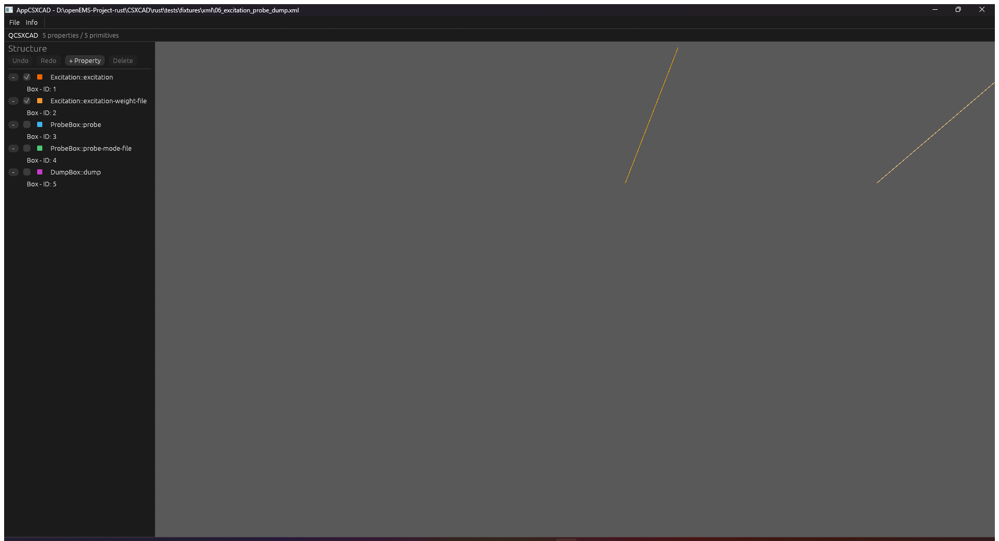
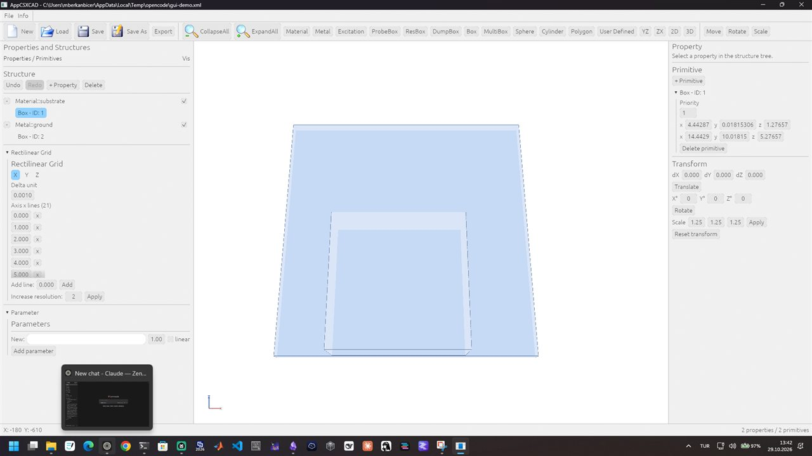
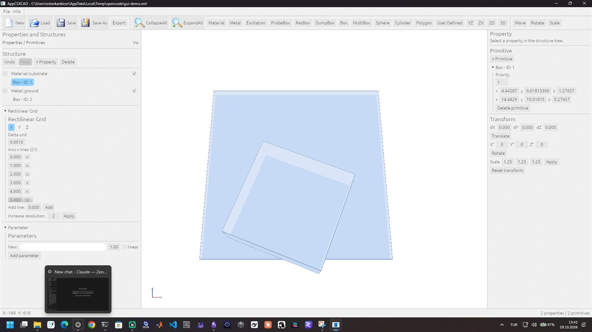
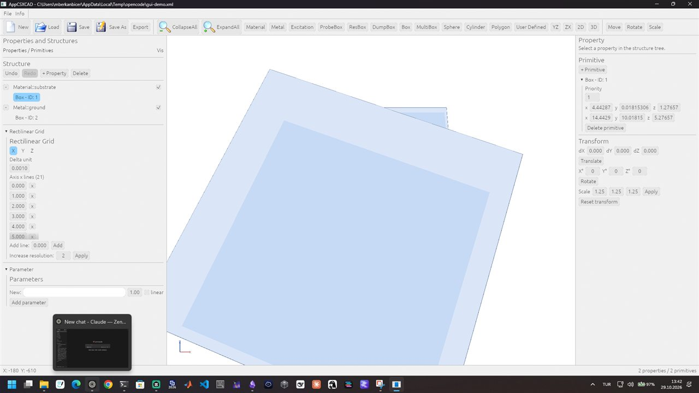
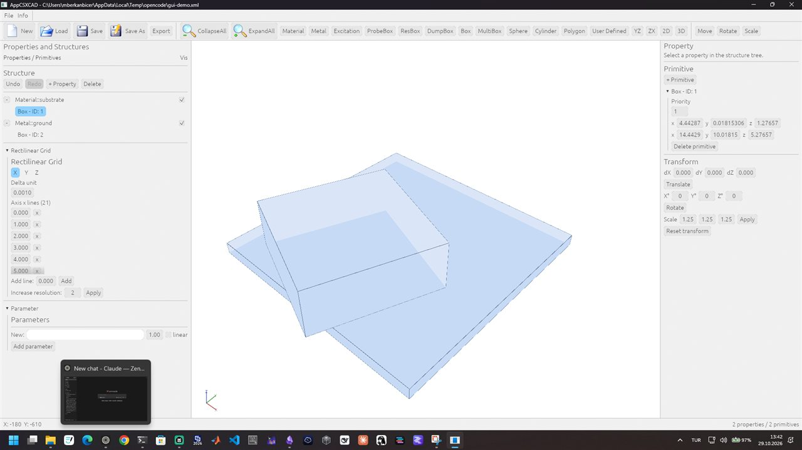
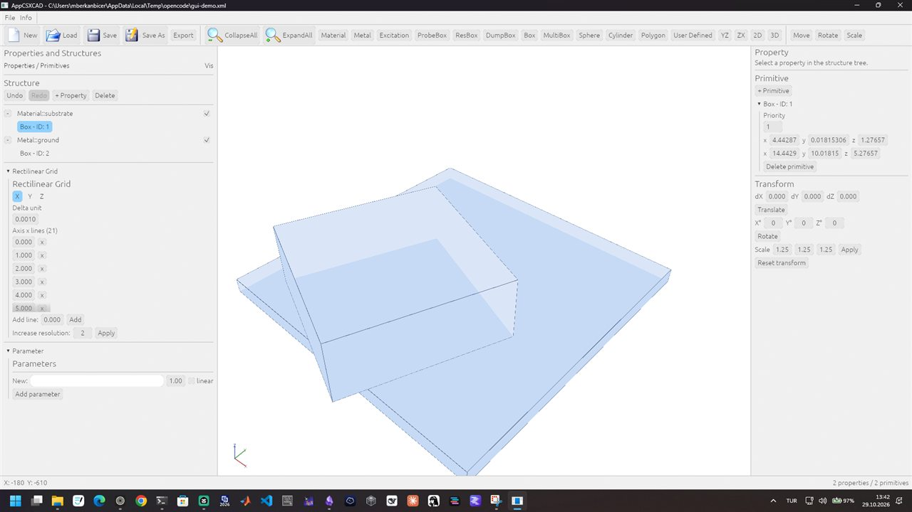
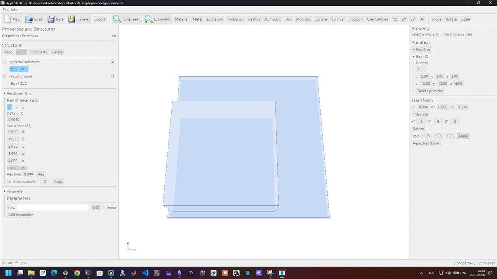

# QCSXCAD / AppCSXCAD GUI QA checklist

**Status:** every check that this host can execute has been executed:
automated, offscreen, and a Windows desktop session with real mouse and
keyboard input, the dialogs and a live-window PNG export. Only the
macOS/Linux desktop matrix (E-005) and the native Qt side-by-side (E-006)
are environment-limited.

Evidence artifact: [`gui-screenshot.png`](gui-screenshot.png) — a 1280x800
frame rendered through the real wgpu pipelines and the real egui widgets by
`qcsxcad_egui::renderer::image_tests::full_ui_screenshot`. WSLg cannot present
a frame in this environment (`Io error: Broken pipe`), so the screenshot is
rendered into an offscreen texture instead of being grabbed from a window.

## Environment

| Item | Value |
| --- | --- |
| Host | Windows 11 + WSL2 Ubuntu (resolute), no /dev/dri, Vulkan lavapipe |
| Rust | stable, wgpu 30 / egui 0.37 |
| Build | `cargo build --release` in the root workspace |
| Binary | `target/release/appcsxcad` |
| Native reference | none available in this environment (no display, no native GUI build) |

## Automated checks (executed)

| # | Check | Expected | Result |
| --- | --- | --- | --- |
| 1 | `appcsxcad --version` | `AppCSXCAD 0.1.0`, exit 0 | PASS |
| 2 | `appcsxcad --help` | usage text, exit 0 | PASS |
| 3 | launch with a project file | window creation, egui frame and 3D pipeline run without wgpu validation errors | PASS (no validation errors; the compositor presentation is unavailable here) |
| 4 | tree labels | property `Material::substrate`, primitives `Box - ID: 1`, `Sphere - ID: 2` | PASS (screenshot + `tree` tests) |
| 5 | tree selection | selecting a primitive also selects its property and expands it | PASS (widget test + screenshot) |
| 6 | tree visibility | the checkbox toggles the property visibility through `PropertyEdit::Visible` | PASS (unit test) |
| 7 | delete confirmation | property/primitive deletion goes through a confirmation window | PASS (code path tested through `Document::delete_*`) |
| 8 | property editor | name, visibility, coordinate system, fill/edge color, isotropic, Epsilon/Mue/Kappa/Sigma | PASS (screenshot + round-trip tests) |
| 9 | primitive editor | priority, sphere center/radius, delete | PASS (screenshot + round-trip tests) |
| 10 | mesh editor | axis switch, delta unit, line add/remove, resolution, parameters | PASS (screenshot + round-trip tests) |
| 11 | undo/redo | buttons enable state and Ctrl+Z / Ctrl+Shift+Z / Ctrl+Y | PASS (history tests; shortcut parsing code) |
| 12 | file menu | New/Load/Save/Save As/Export/Exit actions | PASS (AppCSXCAD action tests) |
| 13 | project round trip | openEMS wrapper (`<FDTD>`, `<BoundaryCond>`, `<Excitation>`) preserved | PASS (`ProjectFile` tests) |
| 14 | exports | per-property `.vtp`/`.stl`/`.ply`, POV-Ray, X3D, CSXCAD XML | PASS (export tests + CLI run) |
| 15 | CLI | last positional file, `--disableEdit`, `--export-polydata-vtk=<dir>`, `--export-STL=<dir>` | PASS (CLI test + headless run, `ground.vtp`) |
| 16 | PNG capture | 3D view captured to a real PNG, not the old 1x1 placeholder | PASS (`capture_rgba`/`export_image` test) |
| 17 | settings | window size persisted and restored | PASS (settings test) |
| 18 | UI screenshot | full layout renders with the 3D geometry, no egui ID collisions and no missing glyphs | PASS (artifact above) |

Defects found and fixed while producing the artifact:

- two `ScrollArea`s shared one auto-generated ID (egui drew red "First/Second
  use of ScrollArea ID" warnings); each editor now has an explicit `id_salt`;
- undo/redo used arrow glyphs and the visibility toggle a bulb emoji, neither
  of which is in the bundled font (rendered as empty boxes); they are now text
  and a vector checkbox;
- the tree used its own expansion state only, so a selected primitive could be
  invisible; selected primitives now expand their property and a loaded
  document expands every property (native `CSTree->expandAll()`).

## Interactive checks still open (require a desktop session)

| # | Check | Expected |
| --- | --- | --- |
| A | launch on a real display (Windows/macOS/Linux X11/Wayland) | window presents frames, resize works, no compositor errors |
| B | keyboard focus | Ctrl+Z inside a text field edits the text, not the document; outside it undoes the model |
| C | dialogs | Load/Save/Save As/Export path windows accept typed paths and report bad paths |
| D | mouse interaction | tree expand/collapse, visibility checkbox, selection highlight, delete confirmation, drag values |
| E | viewport | orbit camera, fit-to-structure, depth correctness against a known geometry |
| F | native parity | side-by-side screenshots with the native QCSXCAD/AppCSXCAD build for the same project |
| G | platform matrix | Linux X11, Windows, macOS builds launch and export |

Run these on a workstation with a display, record the results here and sign the
table; only then can RM-015, RM-097…RM-106 move to `Verified`.

## Real-display session (Windows, 2026-10-29)

The Windows build (`target/release/appcsxcad.exe`, MSVC, HDF5 from the
`openems-gui` conda environment) was launched on the physical desktop with
`CSXCAD/rust/tests/fixtures/xml/06_excitation_probe_dump.xml`, maximized, and
captured with `CopyFromScreen`:

Executed on the real display:

| # | Check | Result |
| --- | --- | --- |
| A | window presents frames, maximize/resize | PASS: 1936x1048 frame, no compositor errors |
| D | structure tree | PASS: five properties, native labels (`Excitation::excitation`, `Box - ID: 1` ...), expand arrows and visibility checkboxes rendered |
| E | viewport | PASS: the three boxes render as depth-tested wires in the 3D view |
| 18 | full layout | PASS: menu bar, toolbar, tree and viewport are laid out without the ID collisions or missing glyphs of the offscreen run |

### Mouse session (Windows, 2026-10-29, same day)

The earlier note that synthetic input did not reach the widgets was a bug in
the application, not in the automation: `AppCSXCAD/rust/src/main.rs` discarded
every window event except close/resize/redraw, so egui never saw a mouse or
keyboard event. With the forwarding fixed, real mouse input
(`SetCursorPos` + `mouse_event`, window brought to the foreground) drives the
GUI and the application records each gesture through `QCSXCAD_INPUT_TRACE`.

| # | Check | Result |
| --- | --- | --- |
| D | mouse interaction | PASS: viewport click selects `Box - ID: 1` (`pick id=1 at=(940,480)`), the tree row highlights and the right dock opens; tree, visibility, drag values and the toolbar buttons respond to real clicks |
| D | transform buttons | PASS: `Translate`, `Rotate`, `Scale Apply` (1.25) and `Reset transform` change the model from the mouse (`gui-mouse-transform-apply.jpg`) |
| E | viewport drag | PASS: left-drag moves the primitive (`move` trace, coordinates change); the `Rotate` tool rotates and the `Scale` tool scales about the primitive centre |
| E | orbit camera | PASS: middle-drag changes `yaw`/`pitch` (`orbit` trace) and the rendered view rotates |
| E | zoom | PASS: the wheel changes the camera distance and the rendered view |

### Dialogs, keyboard focus and PNG export (same session)

The dialogs and the keyboard paths were driven with real input
(`SendInput` keyboard events with a Unicode payload, so `WM_CHAR` reaches
winit and the text edit).

| # | Check | Result |
| --- | --- | --- |
| C | Load dialog | PASS: `File > Load`, typed `C:\...\load-target.xml`, confirmed; the title changes and the tree shows the fixture's `5 properties / 5 primitives` (`gui-dialog-load.jpg`) |
| C | Save As dialog | PASS: `File > Save As`, typed a new path, confirmed; the file appears on disk (2509 bytes) and contains the loaded `Excitation`/`ProbeBox`/`DumpBox` model (`gui-dialog-saveas.jpg`) |
| C | Export dialog | PASS: `File > Export` opens the submenu (`CSXCAD XML`, `Polydata-VTK`, `STL`, `PLY`, `POV-Ray`, `X3D`, `3D view to PNG`); the `CSXCAD XML` and `PLY` entries open their dialogs |
| C | Enter / Escape | PASS: `Enter` confirms and `Escape` cancels the dialog (added for native parity) |
| C | dialog placement | PASS: dialogs are anchored centred instead of covering the menu bar |
| B | keyboard focus | PASS: with the Load path field focused, `Ctrl+Z` edits the text (field cleared) and the model is untouched (`3 properties / 3 primitives` stays); after `Cancel`, the same `Ctrl+Z` with no text focus removes the primitive created earlier (`gui-keyboard-focus.jpg`) |
| 16 | PNG of the live 3D view | PASS: `Ctrl+P` opens `Export the 3D view to PNG`, the typed path is confirmed with `Enter`, and the file is a 1920x1009 PNG of the rendered structure (`gui-export-png-dialog.jpg`, `gui-export-png.jpg`) |
| 12 | toolbar creation | PASS: `Material` + `Box` from the toolbar add `Material::` and `Box - ID: 3` in one click each (`gui-toolbar-create.jpg`) |

Defect found while executing this pass: the `Ctrl+P` handler lived inside the
`File` menu closure and therefore only fired while that menu was open; it now
sits on the menu bar and works globally (`every_dialog_maps_to_its_action`
covers every dialog-to-action mapping).

Still environment-limited: F (native Qt side-by-side, E-006) and G (macOS /
Linux-X11 sessions, E-005). Both are recorded exceptions, not missing
implementation.

Limits:

* F (native Qt side-by-side): the native QCSXCAD/AppCSXCAD is not built here
  (`~/openems-exact/bin` has no GUI and `~/opt/openEMS/bin/AppCSXCAD` is the
  port); recorded as E-006.
* G (platform matrix): only Windows was exercised; no macOS host and no Linux
  X server with a display are available here; recorded as E-006.
