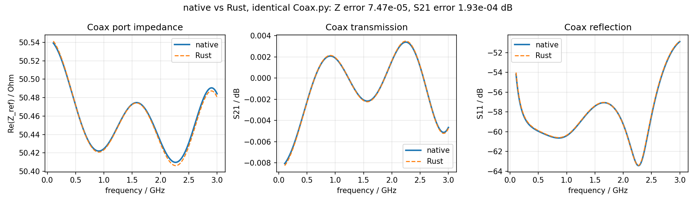
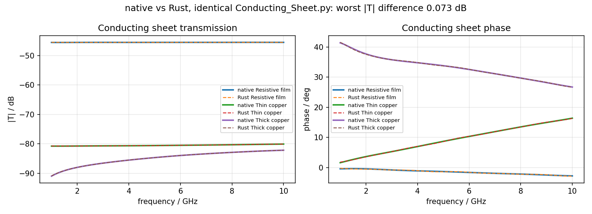
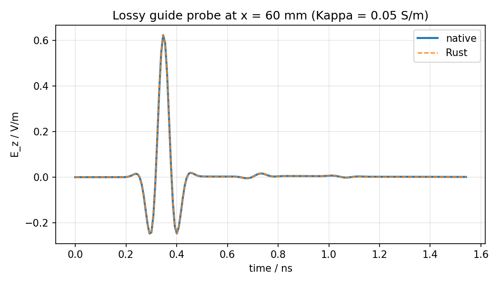
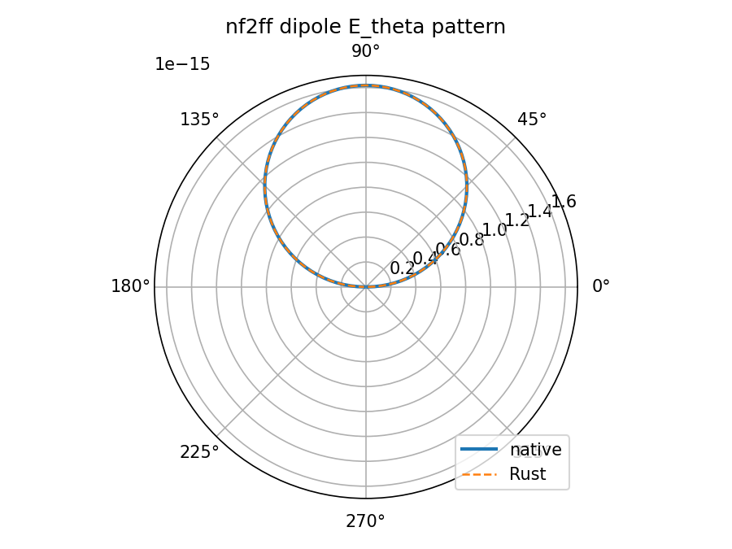

# Scientific parity: native vs Rust on identical inputs

**Date:** 2026-10-29
**Question:** do the original tools and the Rust port produce the same results
on the same examples, and do the subprojects carry a complete port?

## Method

`scripts/ci/plot_scientific_parity.py` runs the unmodified reference sources
against the Rust Python packages, loads the recorded native captures, and
overlays both. The lossy guide runs the same XML through the pinned native
binary and the Rust CLI; the `nf2ff` case runs both binaries on the same
near-field dumps. Native curves are solid, Rust curves dashed.

## Results

| Case | Input | Native vs Rust | Figure |
| --- | --- | --- | --- |
| Coax (3-D, 715 k cells) | unmodified `Coax.py` | `Re(Z_ref)` 7.5e-5 relative, `S21` 1.9e-4 dB | `figures/coax-parity.png` |
| Conducting sheet | unmodified `Conducting_Sheet.py` | worst `|T|` 0.073 dB, phase 0.2 deg | `figures/conducting-sheet-parity.png` |
| Lossy guide | same XML, both binaries | probe trace 7.5e-6 of the peak | `figures/lossy-parity.png` |
| `nf2ff` dipole | same TD dumps, both binaries | `E_theta` pattern 1.2e-6 relative | `figures/nf2ff-parity.png` |









Reproduce with:

```bash
PYTHONPATH=openEMS/rust-py/python:CSXCAD/rust-py/python \
  python3 scripts/ci/plot_scientific_parity.py
```

The curves are inside the approved bounds in `REFERENCE_TOLERANCES.md`; no
tolerance was changed for these figures.

## Are the subprojects fully migrated?

| Subproject | Port | Evidence | Residual difference |
| --- | --- | --- | --- |
| `fparser` | yes | 52 crate tests; 36,717-expression differential against GCC/MSVC | E-001: only `f64` is maintained (no MPFR/GMP/long double) |
| `CSXCAD` | yes | 150 native Python cases, byte-identical XML fixtures, HDF5 read/write | The C++ API is not reproduced (D-08); XML is the compatibility surface |
| `openEMS` | yes | 51-case differential harness, Octave 10/10, analytic suite, lossy/UPML/nf2ff figures above | SSE engines map to the scalar kernel (ADR 0002); 1.8-3.8x slower than native |
| `QCSXCAD` | model/renderer yes, UI no | tessellation/renderer/export tests, offscreen capture | **GUI design parity missing** (`gui-parity.md`) |
| `AppCSXCAD` | model/CLI/exports yes, UI no | CLI and export tests, real-display session | **GUI design parity missing** (`gui-parity.md`) |
| `hyp2mat` | yes | 114 tests, 9/9 native model dumps read back by native CSXCAD | 2/9 arc fixtures differ by one 10 µm vertex (bound still marked approval-pending in `REFERENCE_TOLERANCES.md`) |
| `CTB` | yes | transforms, network operations, Touchstone v1/v2, `ctb` CLI + M-files | MATLAB-only workflows that need Octave itself remain M-file driven by design |
| Root build/docs/CI | yes | 13/13 acceptance, install layout, docs build | E-005: hosted platform matrix/nightly unavailable, local job substitutes |

**Verdict:** the numerical and format paths are at parity within the recorded
bounds. The one substantive gap is the **GUI design and usability**, which is a
toolkit-level difference, not a solver difference.
